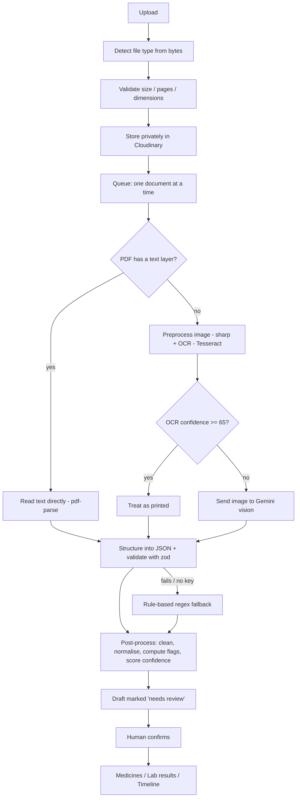
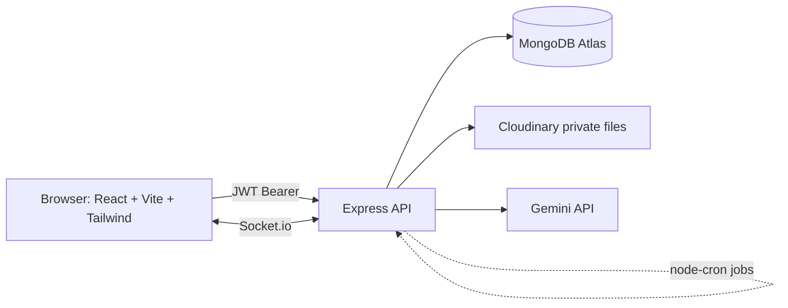

# MediVault

**A patient-owned health record, built from your paper documents.**

You upload a prescription or a lab report. MediVault reads it, **a human reviews and confirms it**, and only then does it become structured health data - medicines with reminders, lab trend charts, a health timeline, and secure share links for a doctor.

> **Core rule: nothing becomes health data until a human confirms it.** Automated reading is only a draft. A person approves every record.

> Not medical advice. MediVault records and organises health information only.

---

## 🔗 Quick links

| What | Link |
|------|------|
| **Live app** | https://medi-vault-green.vercel.app |
| **API health check** | https://medivault-server-vi3c.onrender.com/api/health |
| **Source code** | https://github.com/garvitsachdevaa/MediVault |
| **Demo video** | https://drive.google.com/drive/folders/1A3iWroSb58YVdhGD4blTDgph994U-x75?usp=sharing |

### Demo accounts

Log in with these to explore a fully loaded account - no signup needed.

| Role | Email | Password | What it shows |
|------|-------|----------|---------------|
| **Account owner** | `demo@medivault.app` | `Demo@12345` | Two profiles - *Demo – Mom* (fully loaded) and *Demo – Dad*. Lab tests on 6-month trends, home BP/weight/sugar readings, active medicine courses with dose history, documents, past & upcoming visits, a timeline, comments, and a doctor share link. |
| **Caregiver** | `priya@medivault.app` | `Demo@12345` | A *caregiver* on *Demo – Mom*, to show roles and family sharing. |

> Reseed this demo data any time: `cd server && npm run seed:demo -- --confirm`

---

## ❓ The problem

Most people's health history lives on paper: prescription slips, lab reports, discharge summaries - stuffed in drawers, folders, or phone photos.

| Pain point | What it causes |
|------------|----------------|
| Records are scattered across clinics and labs | No single view of your own health |
| Paper gets lost, faded, or forgotten | Tests get repeated, history is incomplete |
| Numbers (sugar, BP, cholesterol) aren't tracked over time | Trends and warning signs go unnoticed |
| Medicine schedules are easy to miss | Doses skipped, courses not finished |
| Sharing with a new doctor means carrying a file | Slow visits, missing context |
| Families manage health for parents & kids | No safe way to share access |

Hospital portals like *MyChart* solve some of this - but they only hold **one hospital's** data, and **you don't own it**. Your health history should belong to **you**, wherever it was created.

## 💡 Why MediVault

MediVault turns that pile of paper into **one organised, patient-owned record**:

- **You own it** - not a hospital, not a single lab.
- **Any document works** - a photo, a scan, or a PDF from any clinic.
- **It stays trustworthy** - automated reading only drafts a record; a human always confirms before it counts.
- **It's shareable and safe** - invite family with roles, give a doctor a temporary, expiring link.

---

## ✨ What the app does - features in full

MediVault is organised into tabs. Here is every major function.

### 📄 Records - upload & review (the heart of the app)
| Feature | Description |
|---------|-------------|
| Upload | Add a prescription or lab report as an image or PDF. |
| Live processing | Watch real-time progress as the document is read (via live socket updates). |
| Human review | The reading produces a **draft** marked *needs review*. You check and edit the extracted medicines / results, then **confirm**. |
| Confirm = health data | Only on confirm does the draft become medicines, lab results, and timeline events - in a single safe transaction. |
| Timeline | A chronological view of everything (uploads, visits, results). Filter by type and search. |
| Documents grid | All files with status (processing / needs review / confirmed) and per-document detail. |
| Comments | Family members can comment on a document. |

### 🏠 Home
A dashboard: today's doses, documents waiting for review, latest results, the next visit, and recent activity.

### 🫀 Health Summary
Allergies, conditions, and immunisations, with a patient header showing age and blood group.

### 💊 Medicines
| Feature | Description |
|---------|-------------|
| Courses | Active and completed medicine courses with plain-language frequency ("twice a day after food"). |
| Today's doses | What to take today, with **Taken / Skip** buttons. |
| Dose history | Adherence history per course and course progress. |
| Reminders | Live dose reminders while the app is open. |

### 📈 Results
| Feature | Description |
|---------|-------------|
| Trend charts | Lab values plotted over time with a **reference band**; out-of-range points highlighted. |
| Lab vs home | Compare lab results against your own home readings. |
| Log readings | Record BP, blood sugar, or weight yourself. |
| Flags | In-range / out-of-range flags are computed **in our own code** by comparing values to reference ranges - never taken from the reader. |

### 🗓️ Visits
Log appointments (past and upcoming), get a day-before reminder, and manage **doctor share links**.

### 👨‍👩‍👧 Family & access
| Feature | Description |
|---------|-------------|
| Profiles | One account can hold multiple health profiles (e.g. Mom, Dad, a child). |
| Roles | Each member is an **owner**, **caregiver**, or **viewer** - permissions enforced on every request. |
| Invites | Invite family by email with a chosen role. |
| Doctor share links | Generate a temporary, **expiring and revocable** link that shows a doctor a read-only summary - no login needed. |

### 🔔 Notifications
In-app notification centre with a live bell: dose reminders, visit reminders, review-ready alerts, and comments. Browser notifications fire when the tab is hidden.

---

## 🧠 How documents are read (the extraction pipeline)

This is the engine behind "upload → draft". It is designed to **never lose a document** and to **always route to a human for confirmation**.



| Stage | What happens | Why it matters |
|-------|--------------|----------------|
| **Detect & validate** | File type is read from the actual bytes; size, pages, and dimensions are checked. | Blocks bad or fake files before they're stored. |
| **Route** | Text-layer PDFs skip OCR; scans/photos go to OCR. High OCR confidence → printed; low → send the image to a vision model. | Uses the cheapest reliable path per document. |
| **Structure** | Text/image is turned into structured JSON and validated with zod. | Guarantees a clean, predictable shape. |
| **Fallback** | On any failure (bad JSON, quota, or no key) a **rule-based parser** runs. | The document is never lost - just flagged low-confidence. |
| **Flags in our code** | Out-of-range flags come from comparing values to reference ranges in our own code. | Safety numbers are deterministic, not guessed. |
| **Confidence score** | Per-field score from method, OCR↔text cross-check, validation, and dictionary match. Below `0.7` → flagged. | Tells the human exactly what to double-check. |
| **Human confirm** | Nothing becomes health data until a person approves it. | The core trust guarantee. |

---

## 🛠️ Tech stack

Built on the **MERN** stack (MongoDB, Express, React, Node) in a monorepo.

### Frontend (`client/`)
| Area | Technology |
|------|-----------|
| Framework | React 18 + Vite 6 |
| Routing | React Router 6 (lazy-loaded routes) |
| Styling | Tailwind CSS 3 |
| UI primitives | Radix UI + CVA + tailwind-merge |
| Animation | Motion (Framer Motion) |
| Charts | Recharts |
| Real-time | Socket.io client |
| HTTP | Axios |
| Extras | lucide-react icons, react-hot-toast / sonner, qrcode.react |

### Backend (`server/`)
| Area | Technology |
|------|-----------|
| Runtime | Node.js (ESM) |
| Framework | Express 4 (MVC structure) |
| Database | MongoDB Atlas + Mongoose 8 |
| Auth | JWT + bcryptjs |
| Validation | zod |
| Real-time | Socket.io |
| Background jobs | node-cron |
| File storage | Cloudinary (private files, signed URLs) |
| Document reading | Google Gemini API, Tesseract.js (OCR), pdf-parse, sharp |
| Security | helmet, express-rate-limit, express-mongo-sanitize |
| Testing | Vitest + Supertest + mongodb-memory-server |

### Hosting
| Service | Role |
|---------|------|
| **Vercel** | Client (SPA) |
| **Render** | API server |
| **MongoDB Atlas** | Database (M0) |
| **Cloudinary** | Private file storage |
| **cron-job.org / UptimeRobot** | Keep-alive ping |

---

## 🏗️ Architecture



---

## 🔒 Security & privacy

| Protection | How |
|-----------|-----|
| Access control | Per-profile role checks on **every** route; non-members get a 404 (existence is hidden). |
| Passwords | Hashed with bcrypt - never stored in plain text. |
| Auth | Signed JWT sent as a Bearer header. |
| Input safety | zod validation + request sanitisation (`express-mongo-sanitize`) + helmet headers. |
| Rate limiting | Limits on auth and general routes. |
| Files | Stored **privately** in Cloudinary and served via **5-minute signed URLs** only. |
| Invites & shares | Tokens are **hashed** in the database; share links **expire** and can be **revoked**. |
| No secrets in repo | `.env` files are git-ignored; only `.env.example` templates are committed. |

---

## 📁 Project structure

```
MediVault/
├── client/                 # React + Vite SPA
│   ├── src/
│   │   ├── api/            # Axios API wrappers
│   │   ├── components/     # UI, layout, feature components
│   │   ├── context/        # Auth, Profile, Socket, Notification contexts
│   │   ├── pages/          # Landing, auth, and in-app tab pages
│   │   └── App.jsx
│   └── vercel.json
├── server/                 # Express API
│   ├── src/
│   │   ├── config/         # env, db, cloudinary, gemini
│   │   ├── controllers/    # Route handlers
│   │   ├── middleware/     # auth, access, validation, rate limits
│   │   ├── models/         # Mongoose schemas
│   │   ├── pipeline/       # Document ingestion & extraction pipeline
│   │   ├── routes/         # REST routes
│   │   ├── services/       # storage, notifications, dose scheduling, cascades
│   │   ├── jobs/           # node-cron reminders
│   │   ├── sockets/        # Socket.io setup
│   │   └── scripts/        # seedDemo
│   ├── tests/              # Vitest + Supertest
│   └── render.yaml
└── package.json            # Runs client + server together
```

---

## 🧩 API overview

All routes are under `/api`.

| Base route | Purpose |
|-----------|---------|
| `/auth` | Register, login, current user |
| `/profiles` | Health profiles & members |
| `/invites` | Family invitations |
| `/documents` | Upload, process, review, confirm |
| `/comments` | Comments on documents |
| `/medications` · `/doses` | Medicine courses & dose logging |
| `/visits` | Appointments & reminders |
| `/shares` | Doctor share links |
| `/public` | Read-only doctor view (no login) |
| `/notifications` | In-app notifications |
| `/health` | Service health check |

---

## 💻 Local setup

**Prerequisites:** Node.js 20+, a MongoDB Atlas URI, and (optional) Cloudinary + Gemini keys.

```bash
# 1. Install dependencies (root, server, client)
npm install
npm install --prefix server
npm install --prefix client

# 2. Create env files from the templates
#    server/.env  (see table below)
#    client/.env  -> VITE_API_URL + VITE_SOCKET_URL

# 3. Run client + server together
npm run dev

# 4. (Optional) load demo data
npm run seed:demo --prefix server -- --confirm
```

The app runs at `http://localhost:5173` (client) and `http://localhost:5000` (API).

### Environment variables

**`server/.env`**

| Variable | Required | Description |
|----------|:--------:|-------------|
| `MONGO_URI` | ✅ | MongoDB Atlas connection string |
| `JWT_SECRET` | ✅ | Long random string (≥ 16 chars) |
| `JWT_EXPIRES_IN` | | Token lifetime (default `7d`) |
| `CLIENT_URL` | | Allowed origin(s), comma-separated (CORS) |
| `CLOUDINARY_CLOUD_NAME` · `CLOUDINARY_API_KEY` · `CLOUDINARY_API_SECRET` | | File storage (uploads disabled without these) |
| `GEMINI_API_KEY` · `GEMINI_MODEL` | | Document reading (falls back to rule-based parser if absent) |
| `OCR_CONFIDENCE_THRESHOLD` | | Printed-vs-handwritten cutoff (default `65`) |
| `REVIEW_CONFIDENCE_THRESHOLD` | | Flag-for-review cutoff (default `0.7`) |
| `MAX_UPLOAD_MB` | | Max upload size (default `10`) |
| `APP_TIMEZONE` | | Reminder timezone (default `Asia/Kolkata`) |

**`client/.env`**

| Variable | Description |
|----------|-------------|
| `VITE_API_URL` | API base, e.g. `http://localhost:5000/api` |
| `VITE_SOCKET_URL` | Socket base, e.g. `http://localhost:5000` |

> `.env` files are never committed - copy `.env.example` and fill in your own values.

---

## 🚀 Deployment

The client (Vercel) and server (Render) deploy separately.

**Server → Render**
New Web Service → root `server`, build `npm install`, start `npm start`, Node 20. A `server/render.yaml` blueprint is included. Add env vars from `server/.env.example`. Health check: `/api/health`.

**Client → Vercel**
Import the repo → root `client` (Vite). Set `VITE_API_URL=https://<render-url>/api` and `VITE_SOCKET_URL=https://<render-url>`. `client/vercel.json` rewrites all routes to `index.html`.

**Connect & keep awake**
Set `CLIENT_URL` on Render to your full Vercel URL (no trailing slash). Render's free tier sleeps after ~15 min idle, so add a cron-job.org / UptimeRobot ping to `/api/health` every 10 minutes to keep reminders running.

---

## ✅ Testing

```bash
npm test --prefix server
```

**53 tests** (Vitest + Supertest, against an in-memory MongoDB) covering auth, profiles / roles / invites, health summary, document ingestion, extraction post-processing, review & confirm transactions, notifications, and dose scheduling.

---

## ⚠️ Limitations

- Reminders fire only while the server is awake (hence the keep-alive ping) and reach people with the app open (plus a browser notification when the tab is hidden).
- Free Cloudinary requires enabling PDF delivery; signed file URLs are download-style.
- Handwriting accuracy varies - low-confidence fields are flagged for the human reviewer.

## 🔭 Future work

Source highlighting on review (OCR word boxes), refill alerts, duplicate generic-name warnings, adherence streaks, an admin aggregate dashboard, semantic search, dark mode, and a pluggable open-source OCR adapter.
