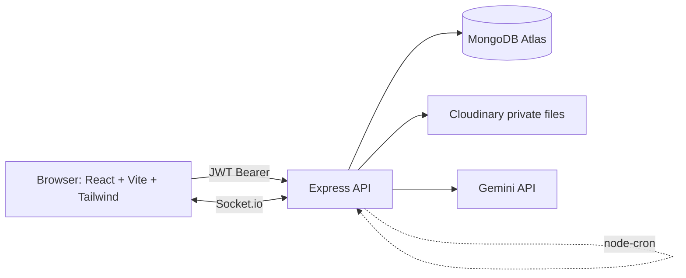
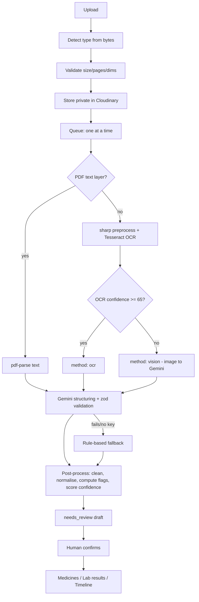

# MediVault

**A patient-owned MyChart, built from your paper records.** Upload a prescription or lab
report, the app reads it, **a person reviews and confirms it**, and only confirmed data becomes
medicines & reminders, lab trend charts, a health timeline, and doctor share links.

> Core rule: **nothing becomes health data until a human confirms it.**

- **Live app:** https://medi-vault-green.vercel.app
- **API:** https://medivault-server-vi3c.onrender.com/api/health
- **Demo login:** `demo@medivault.app` / `Demo@12345`
  — two profiles (*Demo – Mom*, fully loaded, and *Demo – Dad*) with 10 lab tests on 6-month
  trends, home BP/weight readings, 3 active medicine courses with dose-adherence history and
  today's doses, documents, past + upcoming visits, a timeline, comments and a doctor share link.
- **Family demo login:** `priya@medivault.app` / `Demo@12345` (a *caregiver* on *Demo – Mom*, to show roles/sharing)
- Reseed this data any time with `cd server && npm run seed:demo -- --confirm`.

> Not medical advice. MediVault records and organises health information only.

## Features by tab
- **Home** — today's doses, documents needing review, latest results, next visit, recent activity.
- **Health Summary** — allergies, conditions, immunisations; patient header with age/blood group.
- **Records** — a chronological **Timeline** (filter by type, search) and a **Documents** grid with
  live processing progress; upload prescriptions/lab reports; per-document detail + family comments.
- **Medicines** — active/completed courses, plain-language frequency, reminder times, course
  progress, dose history; **today's doses** with Taken/Skip; live dose reminders.
- **Results** — lab trend charts with a reference band, out-of-range points highlighted, lab vs
  home readings; log BP / blood sugar / weight.
- **Visits** — appointment log with day-before reminders, and expiring **doctor share links**.
- **Family & access** — per-profile roles (owner / caregiver / viewer) and email invites.

## Architecture


### Extraction pipeline


### How extraction works (viva notes)
- **Routing:** text-layer PDFs skip OCR; images/scans go to Tesseract. If mean OCR confidence
  is ≥ `OCR_CONFIDENCE_THRESHOLD` (65) it's treated as printed (`ocr`), else handwritten/poor
  (`vision`), where Gemini reads the image directly.
- **Gemini** turns text/image into structured JSON validated by zod. On any failure (bad JSON,
  API/quota error, or no key) it falls back to a **rule-based regex parser** — the document is
  never lost, just flagged low-confidence.
- **Flags are computed in our code** (value vs reference range), never taken from the AI.
- **Confidence per field** = base-by-method × OCR–text cross-check × validation × dictionary
  match. `flagged = confidence < REVIEW_CONFIDENCE_THRESHOLD` (0.7). See
  `server/src/pipeline/postprocess/confidence.js`.
- **A human confirms everything** before it becomes health data.

## Security & privacy
Highlights: per-profile role checks on every route (404 for non-members),
zod validation, rate limits, bcrypt passwords, JWT in a header, **private Cloudinary files with
5-minute signed URLs**, hashed invite/share tokens, expiring+revocable share links, and admin
sees aggregates only.

## Tech stack → course modules
- **Node/Express/MVC, REST, middleware, error handling** — the API layer.
- **MongoDB/Mongoose, schema design, indexes, transactions** — data layer + confirm transaction.
- **Auth (JWT, bcrypt)** — registration/login/roles.
- **React, Router, Context, hooks, lazy-loading** — the SPA.
- **Real-time (Socket.io)** — live progress, reminders, notifications.
- **Background jobs (node-cron)** — reminders & maintenance.
- **Third-party integrations** — Cloudinary (files), Gemini (AI), Tesseract (OCR).
- **Testing (vitest/supertest)** and **deployment (Render/Vercel)**.

## Local setup
```
# server/.env  -> MONGO_URI, JWT_SECRET, CLOUDINARY_*, GEMINI_API_KEY, GEMINI_MODEL
# client/.env  -> VITE_API_URL=http://localhost:5000/api  VITE_SOCKET_URL=http://localhost:5000
npm install && npm install --prefix server && npm install --prefix client
npm run dev            # runs client + server together
npm run seed:demo --prefix server -- --confirm   # optional demo data
```

## Deployment
The client (Vercel) and server (Render) deploy separately.

### Server → Render
New Web Service → root `server`, build `npm install`, start `npm start`, Node 20 (a
`server/render.yaml` blueprint is included). Add env vars from `server/.env.example`. Health
check: `/api/health`.

### Client → Vercel
Import the repo → root `client` (Vite). Env: `VITE_API_URL=https://<render>/api`,
`VITE_SOCKET_URL=https://<render>`. `client/vercel.json` rewrites routes to `index.html`.

### Connect + keep awake
Set `CLIENT_URL` on Render to your **full** Vercel URL (`https://...`, no trailing slash).
Render free tier sleeps after ~15 min idle → add a cron-job.org/UptimeRobot ping to
`/api/health` every 10 minutes (keeps reminders running).

## Testing
`npm test --prefix server` — 53 tests (auth, profiles/roles/invites, summary, ingestion,
extraction post-processing, review/confirm transactions, notifications, dose scheduling).

## Limitations
- Reminders only fire while the server is awake (hence the keep-alive ping) and reach people
  with the app open (plus a browser notification when the tab is hidden).
- Free Cloudinary requires enabling PDF delivery; signed file URLs are download-style.
- Handwriting accuracy varies — low-confidence fields are flagged for the human reviewer.

## Future work
Source highlighting on review (OCR word boxes), refill alerts, duplicate generic-name warning,
adherence streaks, an admin aggregate dashboard, semantic search, dark mode, and a pluggable
open-source OCR adapter.
